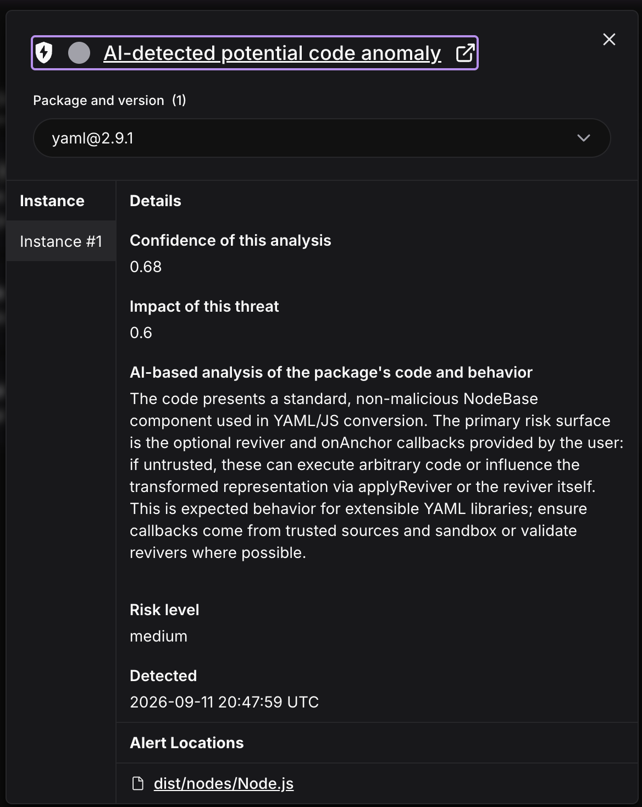
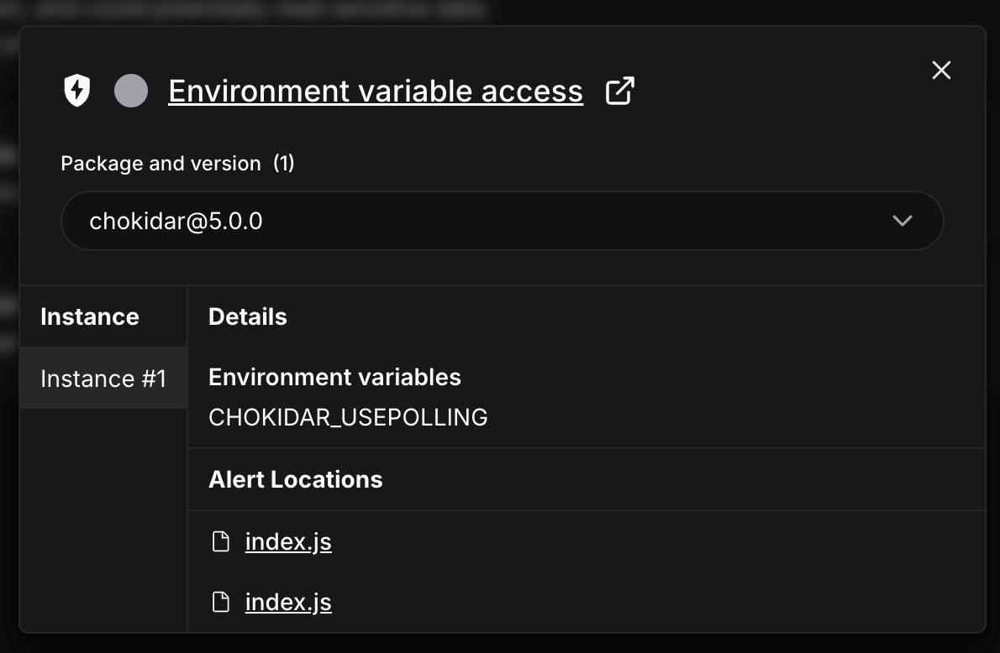
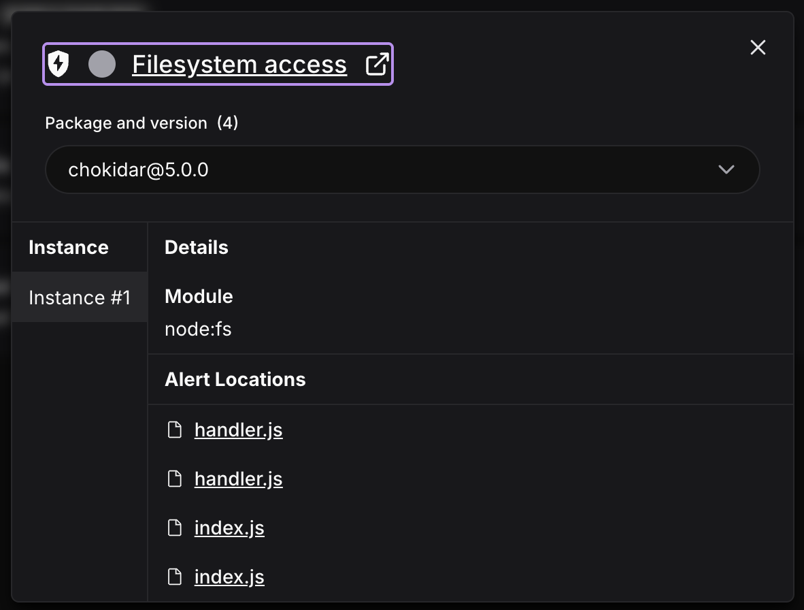
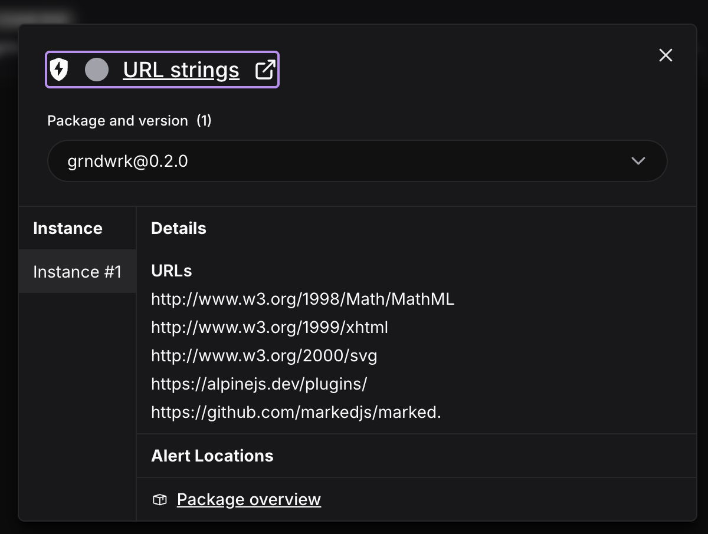

Socket shows four alerts for grndwrk 0.2.0 on npm. To talk through at some point. Claude's first read of each, not yet decided:

- **yaml 2.9.1, "AI-detected potential code anomaly"** (medium, confidence 0.68, `dist/nodes/Node.js`). Socket's own text calls the code standard and non-malicious: the risk is a reviver or `onAnchor` callback the caller passes in. grndwrk passes neither (`src/store/matter.ts:35` calls a plain `parse`), so that path is not used. yaml is the library chosen on 2026-10-13 to replace gray-matter, which ran `---js` frontmatter as code.
- **chokidar 5.0.0, environment variable access** (`CHOKIDAR_USEPOLLING`). It reads that one variable to decide whether to poll the disk. Expected for a file watcher.
- **chokidar 5.0.0, filesystem access** (`node:fs`). Watching `.grndwrk/` is what grndwrk uses it for.
- **grndwrk 0.2.0, URL strings**: w3.org namespaces (DOMPurify's SVG and MathML handling), alpinejs.dev and the marked repository, inside the bundled UI. Strings only: the page's Content-Security-Policy lets it load nothing from another server.

None of them looks like a vulnerability. The questions are whether to say so somewhere people see it, and whether fewer alerts is worth a change, for example Node's own `fs.watch` instead of chokidar, or leaving library URLs out of the bundle.

